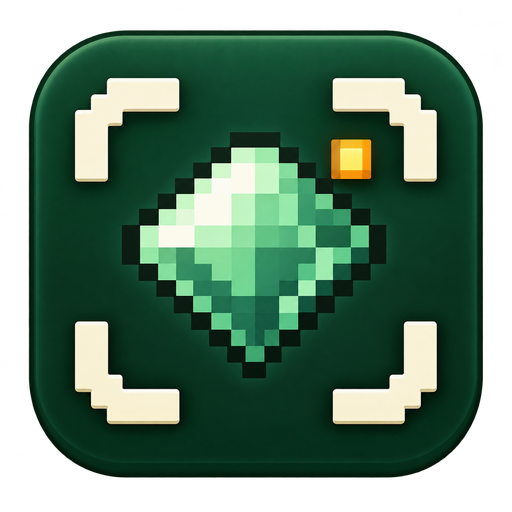
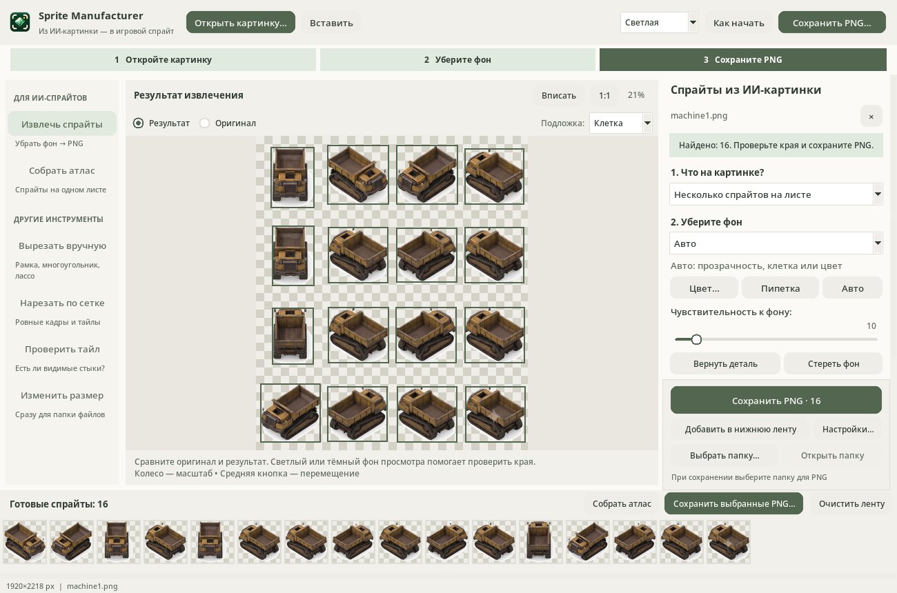
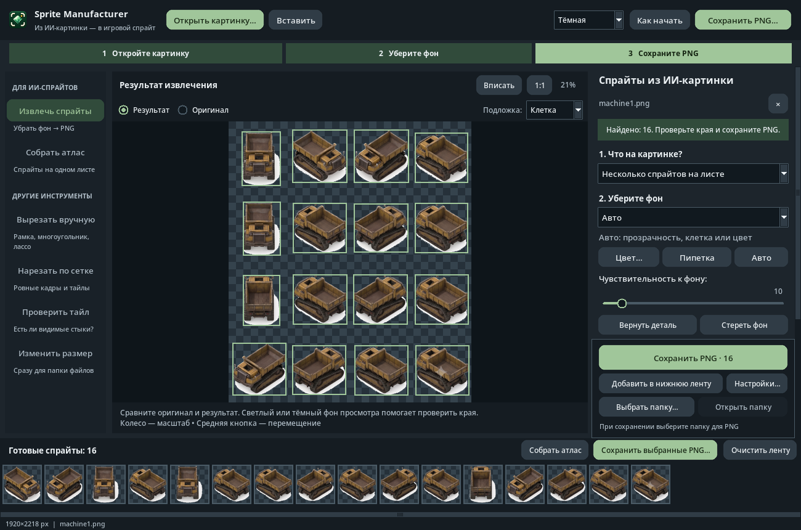

<p align="center">
  
</p>

<h1 align="center">Sprite Manufacturer</h1>
<p align="center"><strong>От ИИ-картинки — к спрайтам для игры</strong><br>Turn AI-generated artwork into usable game sprites.</p>

<p align="center">
  <a href="https://github.com/Shtilluz/ImageCuter/releases/latest/download/gui_cutter.exe"></a>
</p>

[Русский](#russian) · [English](#english) · [Releases](https://github.com/Shtilluz/ImageCuter/releases)

<a name="russian"></a>
## Русский

**Sprite Manufacturer заточен под подготовку игровых спрайтов из картинок, сгенерированных ИИ.** Загрузите лист персонажей, предметов или техники из вашего генератора, уберите фон, поправьте края и получите отдельные PNG с прозрачностью. Готовые спрайты можно собрать в атлас — один лист текстур для игры.

Основной сценарий: **открыть картинку → убрать фон → проверить результат → сохранить PNG**. Всё обрабатывается локально на компьютере, без отправки изображений в облако и загрузки нейросетевых моделей.



<details>
<summary>Посмотреть тёмную тему</summary>



</details>

### Быстрый старт

1. Нажмите **«Открыть картинку…»**, перетащите файл на холст или вставьте его через **Ctrl+V**. Поддерживаются PNG, JPEG, WebP и BMP.
2. Выберите, что на картинке: **несколько спрайтов**, **один персонаж или предмет**, **пиксель-арт**. Начните с фона **«Авто»**.
3. Переключайте **«Оригинал / Результат»**, чтобы проверить выделение. Подложки **«Клетка / Светлый / Тёмный»** помогают увидеть края и прозрачность; на сохранённую картинку они не влияют.
4. Если нужно, нажмите **«Вернуть деталь»** или **«Стереть фон»** и поправьте результат кистью. **Esc** завершает рисование и возвращает просмотр.
5. Выберите папку и нажмите **«Сохранить PNG»**. Кнопка справа остаётся видимой при прокрутке настроек. Каждый найденный спрайт сохраняется отдельным файлом.

Для набора из нескольких картинок нажимайте **«Добавить в нижнюю ленту»**. Клик по миниатюре исключает её из набора; повторный клик возвращает. Затем можно **сохранить выбранные PNG** или нажать **«Собрать атлас»** прямо в ленте.

### Если результат нужно поправить

Кнопка **«Настройки…»** рядом с сохранением открывает **«Размер и края PNG»**: сглаживание, удаление каймы, пиксель-арт и размер результата.

| Что произошло | Что сделать |
| --- | --- |
| Фон остался | Укажите его через **«Цвет…»** или **«Пипетка»**, немного увеличьте чувствительность либо используйте **«Стереть фон»**. |
| Исчезла часть персонажа | Уменьшите чувствительность и воспользуйтесь **«Вернуть деталь»**. |
| Один персонаж разбился на части | Выберите **«Один персонаж или предмет»**. На листе из нескольких персонажей попробуйте **«Объединить близкие части»**. |
| Два спрайта слиплись | В разделе **«Разделение и мелкие части»** настройте разделение. |
| Пропали маленькие эффекты | Уменьшите минимальный размер в том же разделе. Для пиксель-арта есть предустановка с поиском от 1 пикселя. |
| На исходнике нарисована клеточка | Выберите **«Нарисованная клеточка»**. Регулярный рисунок определяется автоматически; искажённый рисунок поправьте кистями. |
| Нужна дополнительная очистка края | Отметьте важные детали кистью **«Оставить»**, затем попробуйте **«Уточнить края автоматически»**. Проверьте тени и свечение после уточнения. |
| На тёмной подложке видна белая или цветная кайма | Включите **«Сгладить края и убрать цвет фона»**. Если кайма осталась, попробуйте **«Сжать край» — 1–2 пикселя**. Большие значения могут срезать тонкие детали; защитите их кистью **«Оставить»**. |
| Под предметом осталась белая тень или отражение | Уберите его кистью **«Стереть фон»**. Сглаживание обрабатывает узкий край; отражение и светлое стекло нельзя надёжно разделить только по цвету. |

### Что умеет программа

- **Убирать фон:** любой однотонный цвет, регулярную нарисованную клетку; сохранять настоящую прозрачность PNG. Внутренние замкнутые детали того же цвета не удаляются обычным удалением фона.
- **Отделять игровые объекты:** листы спрайтов и отдельные персонажи, объединение близких фрагментов, разделение слипшихся объектов, собственная маска каждого спрайта без захвата соседей.
- **Поправлять вручную:** кисти «Оставить / Удалить», радиус кисти, отмена мазка, сброс маски и дополнительное уточнение контура. Правки сохраняются в проекте.
- **Готовить PNG для игры:** частичная прозрачность, поля вокруг спрайта, плавное масштабирование рисованных ассетов и чёткое масштабирование пиксель-арта. Цвет края можно продолжить под прозрачные поля, чтобы уменьшить цветную примесь при фильтрации текстуры.
- **Убирать кайму:** сглаживание контура с очисткой примеси фона и отдельное сжатие края. Для пиксель-арта обработка отключается; настоящая исходная прозрачность и защищённые кистью детали сохраняются. Настройки краёв входят в проект.
- **Собирать атласы:** из выбранных спрайтов, нескольких PNG или исходного листа. Есть настройка ячеек, порядка, масштаба и удаления дублей. Режим без масштаба увеличивает ячейки под крупные спрайты и не обрезает их.
- **Работать с тайлами:** нарезка по сетке и проверка видимых стыков при повторении.
- **Менять размеры папки изображений:** пакетная обработка с сохранением копий, прогрессом и возможностью остановки.

### Интерфейс и темы

- Три темы: **светлая**, **тёмная**, **контрастная**. Переключаются в верхней панели или через **«Вид → Тема интерфейса»**; выбор сохраняется между запусками.
- Три шага сверху показывают путь к результату. Встроенная справка **«Как начать»** объясняет работу с картинкой, кистями и файлами.
- Основные действия всегда доступны. Кнопка **«Настройки…»** рядом с добавлением в ленту показывает разделение, кисти и параметры PNG; редкие настройки собраны в раскрывающиеся разделы. У кнопок и сложных параметров есть подсказки при наведении.
- Зум колесом мыши, перемещение средней кнопкой, управление кнопками и переключателями с клавиатуры.

### PNG, атлас и проект — в чём разница?

| Формат | Для чего нужен |
| --- | --- |
| **Спрайт PNG** | Отдельная картинка с прозрачностью для персонажа, предмета, эффекта или кадра. |
| **Атлас PNG** | Несколько спрайтов, размещённых на одном листе. Импорт и разметка в игровом движке выполняются отдельно. |
| **Проект .smproj** | Исходная картинка, настройки и правки, чтобы продолжить работу позже. Сохраняется через **«Файл»** или **Ctrl+S**. |

### Границы автоматического выделения

ИИ-картинки иногда содержат неровную клетку, слитые контуры, тени и свечение на фоне. Такие места могут потребовать ручной правки. Если деталь совпадает с внешним фоном и соединяется с ним, автоматическое удаление может задеть её. Дополнительное уточнение может убрать нужную тень или частицу — проверяйте результат перед экспортом.

Из JPEG или PNG с уже впечённым фоном нельзя гарантированно восстановить исходную полупрозрачность и цвет каждого края. Для тонких эффектов полезнее исходный PNG с настоящей прозрачностью.

### Запуск из исходников

Нужен **Python 3.9+** с Tkinter.

```bash
pip install -r requirements.txt
python gui_cutter.py
```

Для Linux при отсутствии Tkinter установите пакет `python3-tk` средствами своего дистрибутива. Готовые Windows-сборки доступны в [Releases](https://github.com/Shtilluz/ImageCuter/releases).

### Горячие клавиши

| Клавиши | Действие |
| --- | --- |
| **Ctrl+O / Ctrl+V** | Открыть картинку / вставить из буфера |
| **Ctrl+S** | Сохранить проект для дальнейшей работы |
| **Ctrl+Shift+O** | Открыть проект |
| **Ctrl+0 / Ctrl+1** | Вписать в окно / показать 1:1 |
| **Esc** | Завершить работу кистью, отменить пипетку или текущий контур |

### Автор и лицензия

**Shtillgor** · [midgro.uz](https://midgro.uz/)

Условия использования и указания авторства: [LICENSE_RU.md](LICENSE_RU.md).

---

<a name="english"></a>
## English

**Sprite Manufacturer is built for preparing game sprites from AI-generated artwork.** Open a sheet of characters, props or vehicles from your image generator, remove the background, correct the edges and export individual transparent PNGs. Selected sprites can also be packed into a PNG texture atlas.

The main workflow is **open artwork → remove the background → inspect → save PNG**. Processing runs locally with OpenCV, without cloud uploads or neural-model downloads.

### Quick start

1. Open or drop an image, or paste it with **Ctrl+V**. PNG, JPEG, WebP and BMP are supported.
2. Choose a task: multiple sprites, a single character/object, or pixel art. Start with automatic background detection.
3. Compare the original and result. Checker, light and dark preview backgrounds help inspect transparent edges without changing the exported image.
4. Restore missing details or erase remaining background with the brushes. **Esc** returns to viewing.
5. Choose an output folder and save PNGs using the pinned action on the right.

To collect sprites from several images, add them to the bottom tray. Click a thumbnail to exclude or restore it, then save the selected PNGs or build an atlas directly from the tray.

### Features

- Solid backgrounds of any colour, regular baked-in checkerboards and existing PNG alpha.
- Single-object and sprite-sheet modes, grouping detached parts, splitting touching sprites and isolated per-sprite masks.
- Keep/remove brushes, stroke undo and optional contour refinement; edits persist in `.smproj` projects.
- Partial alpha, transparent padding, nearest-neighbour pixel-art scaling and smooth scaling for painted assets.
- Optional edge colour bleeding into nearby transparent pixels for filtered game textures.
- Soft cutout edges with background colour decontamination and optional inward trimming for halos. Pixel art, native source transparency and protected brush pixels retain their edges. Edge settings are saved in projects.
- PNG atlas packing without clipping large sprites, adjustable cells, reordering and duplicate removal.
- Grid slicing, repeating-tile preview and batch resizing that saves copies.
- Light, dark and high-contrast themes that switch immediately and persist between sessions.
- Beginner presets, a three-step guide, original/result comparison, pinned save controls and contextual tips.

### Limits and file formats

Irregular AI-painted checkerboards, merged silhouettes, backdrop-coloured details, shadows and glow may need manual correction. Refinement can remove wanted details, so inspect the result. Original transparency and edge colours cannot always be reconstructed from a flattened JPEG or PNG.

For a white or coloured fringe, enable **«Сгладить края и убрать цвет фона»** and try **«Сжать край»** at 1–2 pixels. Reflections below glass objects need the remove brush; edge smoothing cannot reliably distinguish a reflection from light glass.

**Sprite PNGs** are individual game images. **Atlas PNGs** contain multiple sprites on one sheet; engine-specific import and slicing are configured separately. **`.smproj` projects** preserve the source and edits for later work and are saved with **Ctrl+S**.

### Run

Windows builds: [Releases](https://github.com/Shtilluz/ImageCuter/releases). For source usage, install Python 3.9+ with Tkinter:

```bash
pip install -r requirements.txt
python gui_cutter.py
```

On Linux, install your distribution's `python3-tk` package if Tkinter is missing.

**Author:** Shtillgor · [midgro.uz](https://midgro.uz/). See [LICENSE_EN.md](LICENSE_EN.md) for usage and attribution terms.
